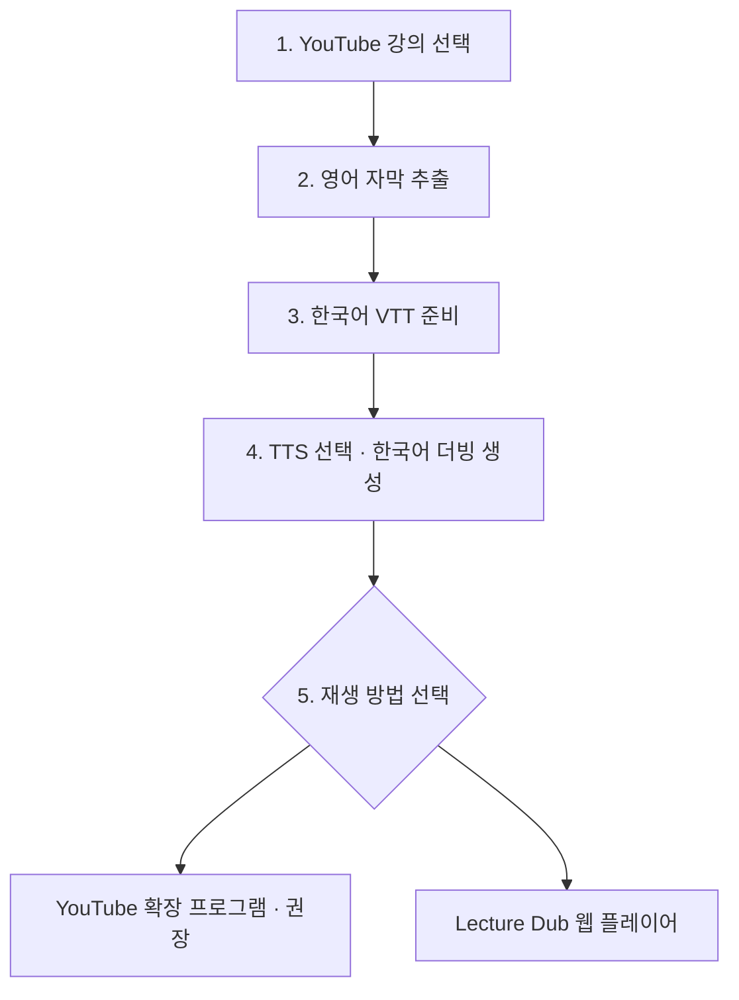

# Lecture Dub

영어 YouTube 강의를 **한국어 더빙으로 듣고, 영어·한국어 자막을 함께 확인할 수 있는 로컬 학습 도구**입니다.

영상 자체를 다시 인코딩하거나 별도로 편집하지 않습니다. YouTube에서 영어 자막을 가져와 한국어 VTT를 준비하고, TTS로 더빙 WAV를 만든 뒤 영상 시간에 맞춰 재생합니다.

## 왜 만들었나요?

긴 영어 강의를 공부할 때 매 문장을 멈춰 번역하거나 영상 전체를 다시 제작하는 과정은 번거롭습니다. Lecture Dub은 다음 작업을 한 흐름으로 묶습니다.

- YouTube 영어 자막 추출
- 한국어 VTT 등록
- 한국어 TTS 더빙 생성
- 영어·한국어 자막 확인
- 영상과 더빙 자동 동기화
- YouTube 원본 페이지에서 더빙 재생
- Edge TTS 또는 사용자가 직접 받은 로컬 TTS 모델 선택

로컬 모델 가중치와 생성한 WAV/VTT는 GitHub 저장소에 포함하지 않고 사용자의 PC나 외장 SSD에서 관리할 수 있습니다.

## 사용 흐름



## 현재 지원하는 TTS

| TTS | 방식 | 특징 |
| --- | --- | --- |
| Edge TTS | 온라인 | 기본 제공, 별도 모델 다운로드 불필요 (*빠름/편리 추천) |
| Qwen3-TTS CustomVoice / VoiceDesign | 로컬 | 로컬 체크포인트 직접 사용, GPU 권장 |
| Supertonic 3 | 로컬 | ONNX 기반, CPU 사용 가능 |
| Fish Audio S2 Pro | 로컬 API | Linux/WSL/Docker 기반 별도 실행 환경 권장 |

로컬 모델은 **Web UI에서 선택**합니다. 모델 파일이 없어도 기존 Edge TTS 기능은 그대로 사용할 수 있습니다.

> Qwen3-TTS `Base` 체크포인트는 감지할 수 있지만 참조 음성이 필요한 모델이므로 현재 Web UI에서는 합성 대상으로 활성화하지 않습니다.

---

# 빠른 시작

## 1. 설치

필요한 항목:

- Python 3.11 이상
- FFmpeg / FFprobe
- 인터넷 연결
- 자막이 제공되는 YouTube 강의
- Chrome 또는 Edge — YouTube 확장 프로그램을 사용할 경우

```powershell
git clone https://github.com/HyunKN/lecture-dub.git
cd lecture-dub

py -3.11 -m venv .venv
.\.venv\Scripts\Activate.ps1
python -m pip install --upgrade pip
pip install -e .
```

Windows에서 FFmpeg가 없다면:

```powershell
winget install Gyan.FFmpeg
```

새 PowerShell을 열고 설치를 확인합니다.

```powershell
ffmpeg -version
ffprobe -version
```

## 2. Web UI 실행

```powershell
lecture-dub serve
```

브라우저에서 다음 주소를 엽니다.

```text
http://127.0.0.1:8000
```

Web UI에서는 다음 순서로 진행합니다.

1. YouTube URL을 입력해 영어 VTT 추출
2. 영어 VTT를 한국어로 번역한 뒤 한국어 VTT 등록
3. TTS 엔진, 모델, 음색, 속도 선택
4. 한국어 더빙 WAV 생성
5. YouTube 확장 프로그램 또는 웹 플레이어에서 재생

한국어 번역은 현재 Lecture Dub이 자동으로 수행하지 않습니다. ChatGPT 같은 번역 도구를 사용해 한국어 VTT를 준비합니다.

## 3. 한국어 VTT 준비

추출한 영어 VTT를 번역 도구에 전달할 때 다음과 같이 요청할 수 있습니다.

```text
이 영어 강의 VTT를 한국어로 번역해줘.

조건:
- 타임코드 유지
- 코드, 변수명, 수식, 모델명은 원문 유지
- 전문용어를 정확하고 일관되게 번역
- TTS로 읽기 좋게 짧고 자연스럽게 번역
- 결과를 UTF-8 WebVTT 파일로 제공
```

번역문이 원래 자막 구간보다 지나치게 길면 최종 음성이 해당 시간에 맞춰 빨라질 수 있습니다. TTS용 번역은 짧고 자연스럽게 작성하는 편이 좋습니다.

---

# 로컬 TTS 모델 사용

Lecture Dub 저장소에 모델 가중치를 넣을 필요가 없습니다. 모델을 원하는 위치에 보관하고 **상위 모델 폴더 하나만 Web UI에 등록**하면 됩니다.

예:

```text
D:\AI\Models
├─ Qwen3-TTS-12Hz-1.7B-CustomVoice
├─ supertonic-3
└─ s2-pro
```

Web UI의 Step 3에서 `D:\AI\Models`를 등록하면 하위 폴더를 검색해 지원 모델을 자동으로 판별합니다.

```text
모델 파일 있음 + 런타임 있음  → 사용 가능
모델 파일 있음 + 런타임 없음  → 모델 발견 · 런타임 설치 필요
모델 파일 없음                → 선택 목록에 표시하지 않음
```

등록한 폴더 위치는 다음 파일에 저장됩니다.

```text
~/.lecture-dub/settings.json
```

따라서 다음 실행부터 같은 위치를 자동으로 다시 검색합니다.

## Qwen3-TTS와 Supertonic 3 런타임 설치

Qwen3-TTS만 사용:

```powershell
pip install -e ".[local-qwen]"
```

Supertonic 3만 사용:

```powershell
pip install -e ".[local-supertonic]"
```

둘 다 사용:

```powershell
pip install -e ".[local]"
```

이 명령은 **실행에 필요한 Python 런타임만 설치**합니다. 실제 모델 가중치는 사용자가 별도로 내려받은 로컬 모델 폴더를 사용합니다.

모델 폴더 구조와 Fish Audio S2 Pro 연결 방법은 [`docs/local-tts-models.md`](docs/local-tts-models.md)를 참고하세요.

---

# 더빙 재생

## 방법 A. YouTube 확장 프로그램 — 권장

Lecture Dub 확장 프로그램은 영상을 별도 iframe에 넣지 않고 **원래 `youtube.com` 시청 페이지의 실제 영상에 로컬 더빙을 동기화**합니다.

이 방식은 영상 소유자가 외부 사이트 임베드를 막아둔 경우에도, 사용자가 YouTube에서 정상적으로 시청할 수 있는 영상이라면 사용할 수 있습니다.

### 설치

1. Chrome에서 `chrome://extensions` 또는 Edge에서 `edge://extensions`를 엽니다.
2. **개발자 모드**를 켭니다.
3. **압축해제된 확장 프로그램을 로드**를 선택합니다.
4. 저장소의 `extension/` 폴더를 선택합니다.

### 사용

1. YouTube에서 강의를 엽니다.
2. 화면 오른쪽 아래의 **Lecture Dub** 버튼을 누릅니다.
3. 생성한 한국어 WAV를 선택합니다.
4. 필요하면 한국어 VTT와 영어 VTT도 선택합니다.
5. **더빙 시작**을 누릅니다.

WAV는 필수이고 VTT 두 파일은 자막 표시를 위한 선택 항목입니다.

확장 프로그램은 YouTube의 다음 상태를 더빙에 맞춰 동기화합니다.

- 재생 / 일시정지
- 영상 탐색(seek)
- 재생 속도
- 현재 재생 시간
- 0.1초 단위 수동 싱크 보정
- 더빙 음량
- YouTube 원음 음소거 전환

YouTube에서 다른 영상으로 이동하면 이전 영상의 더빙은 자동으로 중지됩니다.

다음은 사용 예시 스크린샷입니다. (강의: https://youtu.be/_NLHFoVNlbg?si=5OlOQ_bwTEgayyDX)


자세한 내용은 [`extension/README.md`](extension/README.md)를 참고하세요.

> 이 확장 프로그램은 YouTube의 접근 제한, 유료 콘텐츠 또는 비공개 콘텐츠를 우회하지 않습니다. 사용자가 원래 시청할 수 있는 YouTube 영상의 재생 시간에 로컬 WAV/VTT를 맞춰 재생합니다.

## 방법 B. Lecture Dub 웹 플레이어

Web UI의 **웹 플레이어**에서도 YouTube 영상과 한국어 WAV, 영어·한국어 VTT를 함께 사용할 수 있습니다.

장점은 별도의 학습 화면에서 영상과 두 자막을 함께 볼 수 있다는 점입니다. 다만 YouTube 영상 소유자가 외부 임베드를 차단한 영상은 재생할 수 없습니다. 이런 영상은 위의 **YouTube 확장 프로그램 방식**을 사용하세요.

| 방식 | 장점 | 제한 |
| --- | --- | --- |
| YouTube 확장 프로그램 | 원래 YouTube 페이지에서 사용, 임베드 제한 영향 없음 | Chrome/Edge에 확장 프로그램 설치 필요 |
| Lecture Dub 웹 플레이어 | 독립된 학습 화면과 영어·한국어 자막 UI | 외부 임베드 금지 영상은 재생 불가 |

---

# 생성 파일과 모델 위치

```text
lecture-dub/
├─ output/
│  ├─ en/
│  │  └─ lecture.en.vtt
│  └─ ko/
│     ├─ lecture.ko.vtt
│     └─ lecture.ko.wav
│
└─ models/
   └─ .gitkeep
```

`output/`의 실제 생성 파일과 `models/`의 실제 모델 가중치는 Git에 포함되지 않습니다.

모델은 저장소 외부에 두어도 됩니다.

```text
D:\AI\Models\...
```

---

# CLI 사용

Web UI 없이 영어 자막만 추출할 수도 있습니다.

```powershell
lecture-dub extract "https://www.youtube.com/watch?v=VIDEO_ID"
```

기본 출력 위치:

```text
output/en/
```

현재 CLI의 `synthesize` 명령은 기존 Edge TTS 방식입니다.

```powershell
lecture-dub synthesize output\ko\lecture.ko.vtt `
  --output output\ko\lecture.ko.wav `
  --voice ko-KR-SunHiNeural `
  --rate "+8%"
```

Qwen3-TTS, Supertonic 3, Fish Audio S2 Pro 선택은 현재 Web UI에서 제공합니다.

---

# 자주 묻는 질문

### 영상도 다운로드하나요?

아닙니다. `extract` 단계에서는 영상이 아니라 영어 자막만 가져옵니다. 영상은 YouTube에서 그대로 재생합니다.

### 한국어 번역도 자동으로 하나요?

현재는 아닙니다. 영어 VTT를 추출한 뒤 한국어 VTT는 별도의 번역 도구를 이용해 준비합니다.

### 로컬 모델을 GitHub 저장소 안에 넣어야 하나요?

아닙니다. `D:\AI\Models`처럼 원하는 폴더를 등록하면 됩니다. 모델 가중치는 GitHub에 올리지 않습니다.

### 모델 파일만 있으면 바로 사용할 수 있나요?

모델 폴더와 해당 모델을 실행할 런타임이 모두 필요합니다. Lecture Dub은 둘을 따로 확인해 상태를 표시합니다.

### 웹 플레이어에서 “동영상 소유자가 다른 웹사이트에서 재생할 수 없도록 설정”이라고 나옵니다.

영상 소유자가 YouTube 외부 임베드를 막은 경우입니다. YouTube 확장 프로그램을 사용하면 영상을 다른 사이트에 삽입하지 않고 원래 YouTube 페이지에서 더빙을 사용할 수 있습니다.

### 싱크가 조금 어긋납니다.

플레이어와 확장 프로그램 모두 0.1초 단위로 더빙 타이밍을 보정할 수 있습니다.

---

# 현재 제한 사항

- 한국어 번역은 자동화되어 있지 않습니다.
- 영상에 영어 자막이 없으면 자동 자막 추출을 사용할 수 없습니다.
- Qwen3-TTS Base의 voice cloning은 참조 음성 UI가 필요해 현재 자동 합성 대상으로 비활성화되어 있습니다.
- Fish Audio S2 Pro는 Qwen3-TTS / Supertonic 3보다 별도 환경과 높은 하드웨어 요구사항이 있습니다.
- YouTube 확장 프로그램은 현재 Chromium 기반 Chrome/Edge를 대상으로 합니다.
- YouTube 페이지 구조가 크게 변경되면 확장 프로그램의 플레이어 탐지 로직을 업데이트해야 할 수 있습니다.
- `edge-tts`는 온라인 Microsoft Edge 음성 서비스를 사용하는 비공식 라이브러리이므로 서비스 변경의 영향을 받을 수 있습니다.
- 모델과 런타임에는 Lecture Dub 자체 라이선스와 별개의 라이선스 및 이용 조건이 적용됩니다.

# 개발 및 테스트

개발 의존성 설치:

```powershell
pip install -e ".[dev]"
```

검증:

```powershell
pytest -q
node --check web\player.js
node --check web\app.js
node --check web\local-models.js
node --check extension\content.js
```

# 라이선스

Lecture Dub 자체 코드는 MIT License를 따릅니다. 함께 사용하는 외부 라이브러리, TTS 모델, 온라인 서비스 및 원본 강의 콘텐츠에는 각각의 별도 라이선스와 이용 조건이 적용됩니다.
