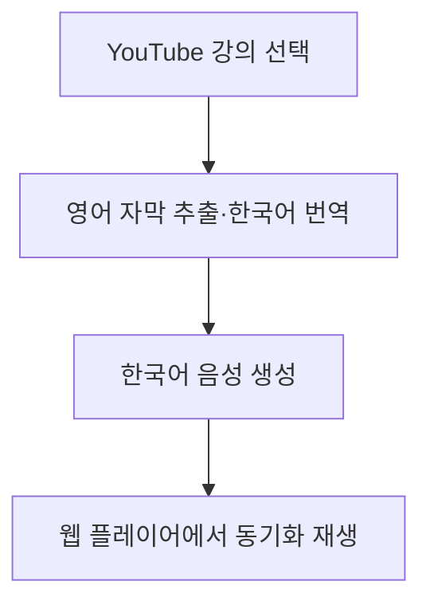

# Lecture Dub

영어 YouTube 강의를 **한국어 음성 + 영어·한국어 자막**으로 함께 학습할 수 있는 로컬 도구입니다.

영상은 다시 인코딩하거나 내려받지 않습니다. YouTube 영상을 그대로 사용하면서, 번역한 자막으로 만든 한국어 음성을 영상 시간에 맞춰 재생합니다.

## 이 도구를 쓰면 좋은 점

- 영어 강의를 멈춰가며 번역하지 않고 한국어 음성으로 들을 수 있습니다.
- 영어 원문과 한국어 자막을 같은 화면에서 함께 확인할 수 있습니다.
- 영상 탐색·재생·일시정지를 해도 한국어 음성이 자동으로 따라갑니다.
- WAV와 VTT 파일은 브라우저에서만 읽으며 별도 서버에 업로드하지 않습니다.
- OpenAI API 키 없이 사용할 수 있습니다.

## 사용 흐름



## 준비물

- Python 3.11 이상
- FFmpeg와 FFprobe
- 인터넷 연결
- 자막이 제공되는 YouTube 강의

한국어 번역은 현재 자동 API가 아니라 ChatGPT 같은 번역 도구를 이용해 직접 준비합니다.

## 1. 설치

```powershell
git clone https://github.com/HyunKN/lecture-dub.git
cd lecture-dub

py -3.11 -m venv .venv
.\.venv\Scripts\Activate.ps1
python -m pip install --upgrade pip
pip install -e ".[dev]"
```

Windows에서 FFmpeg가 없다면 설치합니다.

```powershell
winget install Gyan.FFmpeg
```

새 PowerShell을 연 뒤 설치 여부를 확인합니다.

```powershell
ffmpeg -version
ffprobe -version
```

## 2. 영어 자막 추출

영상은 다운로드하지 않고 영어 자막만 가져옵니다.

```powershell
lecture-dub extract "https://www.youtube.com/watch?v=VIDEO_ID"
```

결과는 기본적으로 `output/en/`에 저장됩니다.

```text
output/
└─ en/
   └─ 강의 제목 [VIDEO_ID].en.vtt
```

영상에 따라 사람이 작성한 자막과 자동 생성 자막이 여러 개 내려받아질 수 있습니다. 가장 정상적으로 문장 단위가 나뉜 영어 VTT를 선택합니다.

## 3. 한국어 자막 준비

추출한 영어 VTT를 ChatGPT 같은 번역 도구에 올리고 다음과 같이 요청합니다.

```text
이 영어 강의 VTT를 한국어로 번역해줘.

조건:
- 타임코드 유지
- 코드, 변수명, 수식, 모델명은 원문 유지
- 전문용어를 정확하고 일관되게 번역
- TTS로 읽기 좋게 짧고 자연스럽게 번역
- 결과를 UTF-8 WebVTT 파일로 제공
```

번역 결과를 다음처럼 저장합니다.

```text
output/ko/lecture.ko.vtt
```

## 4. 한국어 음성 생성

```powershell
lecture-dub synthesize output\ko\lecture.ko.vtt
```

기본 결과:

```text
output/ko/korean_dub.wav
```

음성과 속도를 직접 지정할 수도 있습니다.

```powershell
lecture-dub synthesize output\ko\lecture.ko.vtt `
  --output output\ko\lecture.ko.wav `
  --voice ko-KR-SunHiNeural `
  --rate "+8%"
```

기본 음성은 `ko-KR-SunHiNeural`, 기본 속도는 `+5%`입니다.

실행 중에는 다음 두 단계의 진행률이 표시됩니다.

```text
TTS 생성 [########----------------------] 120/455 (26.4%)
WAV 조립 [##############################] 455/455 (100.0%)
```

번역문이 원래 자막 구간보다 너무 길면 해당 구간의 음성이 빨라질 수 있습니다. 자연스러운 결과를 위해 번역문을 짧게 만드는 것이 좋습니다.

## 5. 웹 플레이어에서 듣기

저장소 루트에서 로컬 서버를 실행합니다.

```powershell
python -m http.server 8000
```

브라우저에서 다음 주소를 엽니다.

```text
http://localhost:8000/web/
```

페이지에서 다음 순서로 준비합니다.

1. YouTube 강의 URL을 입력하고 `확인`을 누릅니다.
2. 생성한 한국어 WAV를 선택합니다.
3. 영어 VTT와 한국어 VTT를 선택합니다.
4. `동기화 재생`을 누릅니다.

영상과 한국어 WAV만 있어도 재생할 수 있으며, 영어·한국어 VTT는 선택 사항입니다.

### 웹 플레이어 기능

- YouTube 영상과 한국어 음성 동기화
- 영상 재생·일시정지·탐색 연동
- 영어·한국어 자막 동시 표시
- YouTube 원본 음성 음소거 전환
- 0.1초 단위 더빙 타이밍 보정
- WAV와 VTT 로컬 처리

자세한 플레이어 사용법은 [`web/README.md`](web/README.md)를 참고하세요.

## 폴더 구조

```text
output/
├─ en/
│  └─ lecture.en.vtt
└─ ko/
   ├─ lecture.ko.vtt
   └─ lecture.ko.wav
```

`output/` 아래의 실제 강의 파일은 Git에 포함되지 않습니다.

## 자주 묻는 질문

### 한국어 번역도 자동으로 해주나요?

현재는 아닙니다. 영어 자막 추출과 한국어 음성 생성은 CLI가 처리하고, 한국어 VTT는 사용자가 번역 도구로 준비합니다.

### 영상도 다운로드하나요?

아닙니다. 자막만 추출하며 웹 플레이어에서는 YouTube 영상을 그대로 불러옵니다.

### WAV와 자막이 서버에 업로드되나요?

아닙니다. 웹 플레이어가 사용자가 선택한 로컬 파일을 현재 브라우저 탭에서만 읽습니다.

### 자막 없이도 사용할 수 있나요?

YouTube 영상과 한국어 WAV가 있으면 재생할 수 있습니다. 영어·한국어 VTT는 자막 표시를 위한 선택 항목입니다.

### 싱크가 조금 어긋나면 어떻게 하나요?

웹 플레이어의 `더빙 타이밍` 버튼으로 0.1초씩 앞뒤로 보정할 수 있습니다.

## 현재 제한 사항

- 한국어 번역은 자동화되어 있지 않습니다.
- YouTube에 영어 자막이 없으면 추출할 수 없습니다.
- `edge-tts`는 온라인 Microsoft Edge 음성 서비스를 사용하는 비공식 라이브러리이므로 서비스 변경의 영향을 받을 수 있습니다.
- 현재 목표는 개인 학습용 로컬 사용입니다. 생성한 음성이나 자막을 공개 배포하기 전에는 원본 콘텐츠와 사용 서비스의 조건을 확인해야 합니다.

## 개발 및 테스트

```powershell
pytest -q
node --check web\player.js
```

## 라이선스

이 프로젝트의 자체 코드는 MIT License를 따릅니다. 함께 사용하는 외부 라이브러리와 서비스에는 각각의 별도 라이선스와 이용 조건이 적용됩니다.
